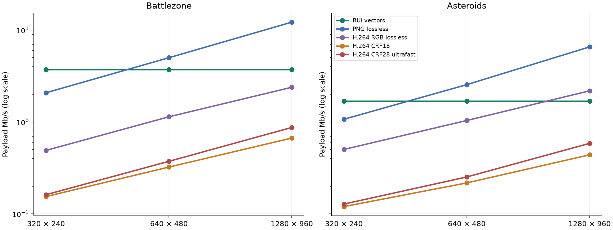
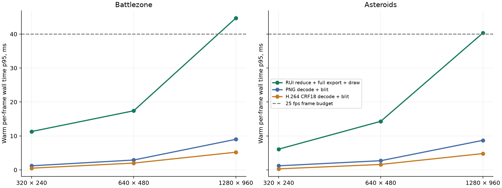
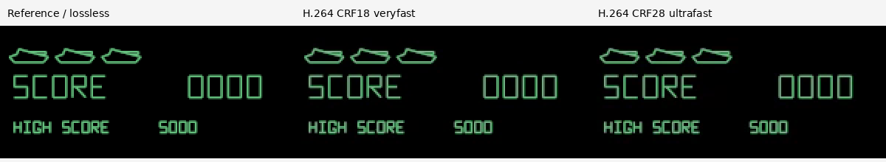
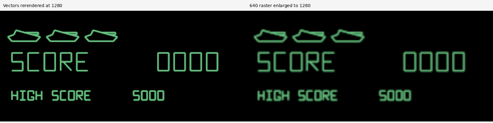

# Vector scenes versus raster delivery in the game demos

Measured on 2026-11-05, on an Intel i7-1280P with Chromium 155 and FFmpeg 9.0.2.

## Findings

The current game adapter uses more bandwidth and more client processing than the tested lossy H.264 streams.
At 640 × 480 and 25 frames/s, Battlezone needs **3.71 Mb/s of RUI publication payload**, versus **0.32 Mb/s for H.264 CRF18 veryfast** and **1.14 Mb/s for exact lossless RGB H.264 veryfast**.
Asteroids needs **1.69 Mb/s**, versus **0.22 Mb/s** and **1.04 Mb/s**, respectively.
These are paired visual-payload measurements, rather than full-session packet captures.

RUI's demonstrated advantages are local vector scaling without a new source stream and bandwidth savings against independent PNG frames at native and 2× resolution.
Its projection/serialization stage is small; complete host CPU savings remain unmeasured.
Its byte count stays constant across the three output sizes, while raster traffic grows with resolution.
At 2× resolution, Asteroids uses **1.69 Mb/s** of RUI payload versus **2.18 Mb/s** of lossless RGB video, saving about **22%**.
Battlezone still favors lossless RGB video at that size.

The adapter's visual representation is a retained list of beam segments.
MAME's hook supplies no tank or asteroid object identities, reusable meshes, or object motion parameters.
The result measures this adapter and renderer; it does not establish an inherent bandwidth limit for semantic UI protocols.
For this prototype, video is a strong graphics baseline, while semantic controls and retained UI state remain separate useful capabilities.

## Paired workload and measurement boundary

The harness starts separate native MAME instances on private authenticated Xvfb displays.
It inserts coins, starts each game, and captures eight seconds at 25 Hz, giving 200 source samples per game.
The input schedule alternates drive/fire, two turning/fire patterns, and idle phases.
Every raster variant uses pixels rendered from the same captured RUI publications, so scene content, frame order, frame count, and colors match within each comparison.
The retained trace hashes identify the exact workloads.

The Rust exporter calls the current game projection and incremental publication builder.
It checks every transaction against a full-snapshot reducer replay.
The browser replays these publications with the existing Rust/WASM receiver and CanvasRenderer at 320 × 240, 640 × 480, and 1280 × 960.
The raster references therefore contain the demo's fixed-width opaque beam presentation, rather than MAME's additive CRT effects or cabinet artwork.
Audio is excluded from every path.

RUI sizes include core Protobuf publication envelopes.
They exclude session chunk framing, acknowledgements, controller traffic, TLS, and socket overhead.
Raster sizes include PNG or H.264 payloads, excluding a prospective media transport and control channel.
The seven semantic controls are omitted from the offline visual trace.
Treat the byte results as paired payload comparisons and lower bounds for complete implementations.

H.264 uses `zerolatency`, zero B-frames, a one-second keyframe interval, and one codec thread.
Both `ultrafast` and `veryfast` settings are retained, with CRF18 and CRF28 lossy cases and CRF0 RGB lossless cases.
PNG uses compression level 3 and independently encodes each frame.
Lossless cases pass an exact decoded RGB comparison for every pixel of every frame.
RGB lossless H.264 is an exactness reference; support on a particular phone is not assumed.

## Bandwidth

All rates are visual-payload Mb/s at 25 workload frames/s.

| Game | Output | Raw RGB24 | RUI | PNG | H.264 RGB lossless | H.264 CRF18 | H.264 CRF28 UF |
| --- | --- | ---: | ---: | ---: | ---: | ---: | ---: |
| Battlezone | 320 × 240 | 46.080 | 3.714 | 2.080 | 0.491 | 0.155 | 0.162 |
| Battlezone | 640 × 480 | 184.320 | 3.714 | 5.000 | 1.139 | 0.323 | 0.373 |
| Battlezone | 1280 × 960 | 737.280 | 3.714 | 12.189 | 2.386 | 0.668 | 0.872 |
| Asteroids | 320 × 240 | 46.080 | 1.693 | 1.071 | 0.502 | 0.120 | 0.128 |
| Asteroids | 640 × 480 | 184.320 | 1.693 | 2.548 | 1.038 | 0.217 | 0.252 |
| Asteroids | 1280 × 960 | 737.280 | 1.693 | 6.558 | 2.182 | 0.439 | 0.585 |

First visual payload at 640 × 480, excluding authentication and browser asset loading.

| Game | RUI snapshot bytes | PNG first image bytes | Lossless RGB H.264 keyframe bytes | CRF18 H.264 keyframe bytes |
| --- | ---: | ---: | ---: | ---: |
| Battlezone | 37,528 | 23,108 | 21,081 | 9,593 |
| Asteroids | 14,611 | 9,288 | 6,195 | 2,536 |

H.264 lossless and CRF18 columns use `veryfast`; CRF28 UF uses `ultrafast`.
All retained encodings, including additional ultrafast cases, are listed in summary JSON.

The table gives the payload needed to deliver all 25 workload frames each second.
It does not assert that every client path sustains that rate.
The unchanged RUI publication stream supplies all three rasterization sizes.
At phone resolution, it pays for the full logical scene even though the displayed pixel count is small.
At larger resolutions, it avoids sending additional pixels, but the browser must do more rasterization work.
The raw RGB comparison shows the large reduction against uncompressed frames; compressed video is the more useful practical baseline.

The H.264 preset matters.
For Battlezone at native resolution, lossless RGB `veryfast` uses about 1.14 Mb/s, compared with 1.92 Mb/s for `ultrafast`, while preserving identical pixels.
Its measured encoder CPU cost is higher.
CRF18 `veryfast` uses fewer bytes than CRF18 `ultrafast`, but their foreground errors differ, so the same CRF value is not a guarantee of equal quality across presets.

## Client and host processing

Warm browser wall time, p95 milliseconds per frame.

| Game | Output | RUI total | RUI draw only | PNG decode/blit | H.264 CRF18 decode/blit |
| --- | --- | ---: | ---: | ---: | ---: |
| Battlezone | 320 × 240 | 11.30 | 9.60 | 1.20 | 0.50 |
| Battlezone | 640 × 480 | 17.40 | 15.80 | 2.90 | 2.00 |
| Battlezone | 1280 × 960 | 44.70 | 42.90 | 9.00 | 5.20 |
| Asteroids | 320 × 240 | 6.10 | 5.50 | 1.20 | 0.30 |
| Asteroids | 640 × 480 | 14.30 | 13.60 | 2.70 | 1.60 |
| Asteroids | 1280 × 960 | 40.30 | 39.70 | 8.70 | 4.80 |

Host stage measurements at 640 × 480.

| Game | RUI project/build/encode wall p95 | PNG CPU/frame | H.264 RGB lossless CPU/frame | H.264 CRF18 CPU/frame |
| --- | ---: | ---: | ---: | ---: |
| Battlezone | 0.189 ms | 3.292 ms | 3.476 ms | 2.267 ms |
| Asteroids | 0.094 ms | 3.172 ms | 3.472 ms | 2.165 ms |

These browser figures are warm wall times measured after preloading the data, with three fresh receiver/renderer or decoder runs and the first five frames of each run excluded.
RUI's total includes reduction, full state export, and drawing.
The standalone replay uses `Receiver.state()`; the live BrowserClient uses incremental state export, so the export stage is not an exact live-client measurement.
The draw stage uses the same renderer as the demo.
Raster timings include browser image/video decoding and canvas submission.
WebCodecs requests `prefer-software`; the actual decoder backend was not inspected.
Neither path measures physical scanout.

At 2× resolution, the measured RUI draw time alone approaches or exceeds the 40 ms budget for 25 frames/s.
The existing CPU renderer clears and composes a complete frame and creates coverage for changed geometry.
This is a client rendering limit, even though the network payload is unchanged.
The desktop's results do not measure phone battery use or predict a phone's software-rendering speed.

The host-side projection/build/encode timer excludes JSON capture and native emulation.
FFmpeg CPU figures include its process work, pixel conversion, and encoding, divided by frame count; they are medians of three whole-clip encodes.
They are aggregate costs, not encoder latency percentiles.
MAME continues to render the local desktop window in the vector demo.
The present implementation therefore avoids video encoding but does not eliminate native host rendering.
A complete server CPU/RSS comparison, including capture and broker work, remains unmeasured.

## Image quality and scaling

Native-resolution quality; foreground error uses 8-bit RGB channel values.

| Game | Encoding | Exact pixels | Full-frame PSNR, dB | Foreground RMSE | Foreground channels with error >8 |
| --- | --- | --- | ---: | ---: | ---: |
| Battlezone | png | Yes | ∞ | 0.00 | 0.0% |
| Battlezone | h264-lossless-rgb-veryfast | Yes | ∞ | 0.00 | 0.0% |
| Battlezone | h264-crf18-veryfast | No | 44.18 | 7.16 | 20.9% |
| Battlezone | h264-crf28 | No | 43.47 | 7.68 | 23.6% |
| Asteroids | png | Yes | ∞ | 0.00 | 0.0% |
| Asteroids | h264-lossless-rgb-veryfast | Yes | ∞ | 0.00 | 0.0% |
| Asteroids | h264-crf18-veryfast | No | 60.21 | 1.93 | 0.3% |
| Asteroids | h264-crf28 | No | 57.26 | 2.69 | 1.5% |

Whole-frame PSNR benefits from the large black background.
The foreground metric therefore selects reference pixels with any RGB channel above 16, expands that mask by one pixel, and measures RGB-byte error in this band.
It is an error diagnostic, rather than a perceptual quality score.
Quality metrics use FFmpeg-decoded pixels; browser decoder timings are measured separately.
The PNG and RGB-lossless results are exact at their encoded resolution.
The tested YUV420 H.264 cases change colored edges and antialiased line values.
The report makes no claim that every visible difference is objectionable during play.

RUI can rerender the same geometry at 1280 × 960 without another source publication format or higher-resolution media stream.
Enlarging a fixed 640 × 480 raster interpolates its existing pixels.
Raster delivery can recover a sharper image by rendering and encoding at the higher source resolution, as included in the bandwidth table, at an additional source/media cost.
This is the clearest demonstrated functional advantage of the vector path.

## Latency, pacing, and network limits

The previous live demo acceptance measured native input acknowledgement, not key-to-photon latency.
Those results cannot be compared directly with video encoding time or the browser processing times above.
This study does not measure a complete raster remote-control implementation, Internet packet loss, WebRTC jitter buffering, or a physical phone's visual latency.

Modeled native-resolution Battlezone serialization time per average frame.

| Link capacity | RUI | Lossless RGB H.264 | CRF18 H.264 | Mean RUI load fits | Mean CRF18 load fits |
| --- | ---: | ---: | ---: | --- | --- |
| 0.256 Mb/s | 580.3 ms | 177.9 ms | 50.5 ms | No | No |
| 1 Mb/s | 148.6 ms | 45.6 ms | 12.9 ms | No | Yes |
| 5 Mb/s | 29.7 ms | 9.1 ms | 2.6 ms | Yes | Yes |

The serialization figures divide measured frame payload bytes by the stated link rate.
They exclude propagation, packet overhead, queuing, processing, and presentation, and are not measured network latencies.
If a stream's average bitrate exceeds link capacity, retaining its full frame rate requires dropping/coalescing updates, reducing quality, or changing the representation.

The current [game producer](../browser-host/src/producer.rs) waits for current presentation readiness before publishing another view update.
That creates a round-trip pacing limit in addition to byte throughput.
At 50 ms RTT, one outstanding publication per round trip permits at most 20 updates/s before accounting for processing and presentation; at 100 ms, at most 10 updates/s.
These are RTT-only upper bounds derived from the implementation, not measured WAN frame rates or limits inherent to vector protocols.
A pipelined video sender need not wait for a presentation acknowledgement after each frame.
RUI's guarded control and publication pacing should be evaluated separately before changing either.

## Why this adapter costs so much, and what to try next

Battlezone: scene mutations account for **97.1%** of warm publication bytes.
Independent zlib level 6 would reduce payload from **3.714 to 0.687 Mb/s**, a **5.4×** reduction, on this exact trace.
Its measured Python compression-call p95 was **0.424 ms** per publication; browser decompression and integration costs were not measured.

Asteroids: scene mutations account for **95.7%** of warm publication bytes.
Independent zlib level 6 would reduce payload from **1.693 to 0.428 Mb/s**, a **4.0×** reduction, on this exact trace.
Its measured Python compression-call p95 was **0.187 ms** per publication; browser decompression and integration costs were not measured.

The current adapter lowers every beam to a transformed rectangle and republishes complete changed scene records.
It repeats record structure, transforms, paint, and version metadata as the game redraws its line list.
A retained scene is useful, but the chosen line granularity captures less reuse than game-object meshes and transforms would.

The following work is supported by these measurements:

1. Prototype bounded, negotiated publication compression and measure its full encode/decode cost and memory ownership.
2. Compare consolidated paths or a compact geometry-update representation with the current rectangle-per-line lowering.
3. Investigate stable source object geometry where an application can provide it.
4. Improve the browser renderer's full-frame composition and changed-geometry coverage cost, with the existing color and correctness checks.
5. Measure observer streaming and control readiness under real RTT and loss, while preserving command authority and bounded queues.
6. Evaluate semantic controls combined with raster/video graphics as an architectural option for high-motion content.

The hypothetical compression figure above is not a deployed feature.
At native resolution, the hypothetical compressed payload would be smaller than both tested lossless RGB streams, while remaining about twice the CRF18 veryfast payload.
Consolidated geometry and object-level updates also require implementation and fresh validation before assigning them a bandwidth benefit.
Semantic phone controls can in principle accompany either visual transport, so their usefulness does not by itself prove that vector graphics are the best delivery method for every application.
A raster/video option would need a new media/profile design because the current strict RUI profile excludes raster content.

## Reproduce and inspect

The [benchmark guide](../demos/games/bench/README.md) gives build, capture, replay, and test commands.
The [retained evidence](../demos/games/evidence/comparison/README.md) contains compact raw samples, trace fixtures, source hashes, encoded-command manifests, and summary JSON.
The larger raw pixels and encoded streams remain reproducible output artifacts rather than repository assets.
A normal development desktop was used, without a dedicated performance host or CPU isolation.
Browser timings have three retained repetitions; native scene capture is one paired clip per game.
Lossless dirty-rectangle/tile raster updates, VP9/AV1, and hardware video paths were not measured.
RFB, for example, can send [framebuffer rectangle updates](https://www.rfc-editor.org/rfc/rfc6143#section-7.7.4), so whole-frame PNG is not the only lossless raster baseline.
These findings should be rechecked with representative GTK/browser workloads, longer game sessions, and physical mobile devices before making a general product claim.

The codec and browser interfaces are documented in [FFmpeg's libx264 options](https://ffmpeg.org/ffmpeg-codecs.html#libx264_002c-libx264rgb), the [WebCodecs specification](https://www.w3.org/TR/webcodecs/), and [MAME's vector-device callbacks](https://docs.mamedev.org/luascript/ref-devices.html#vector-device).
